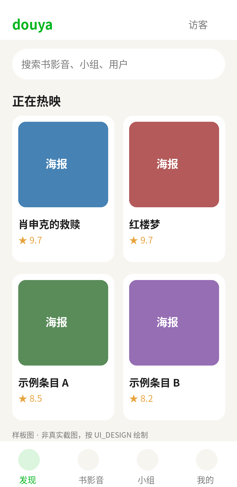
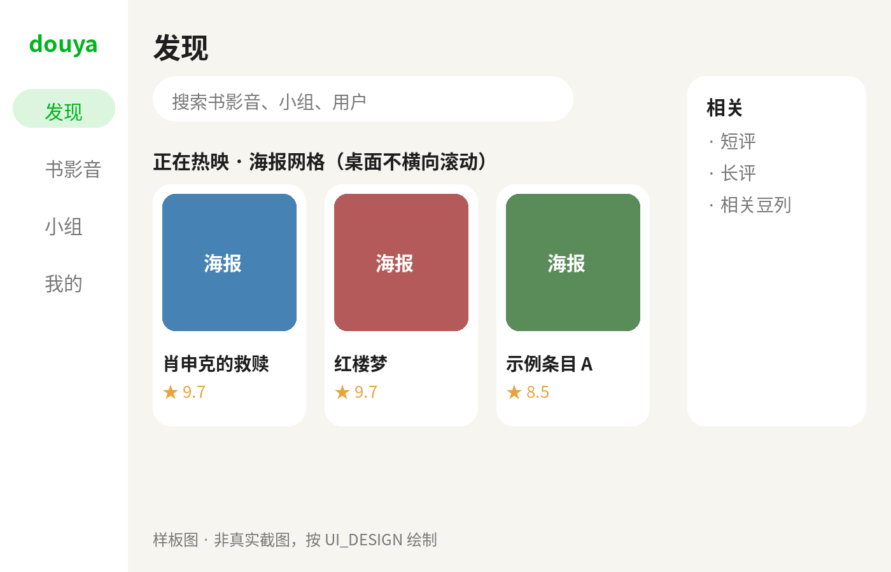

# douya


一个访客只读的豆瓣客户端，用 Flutter 写，一套代码跑桌面和移动端。

> 注意：这个 `douya` 是本项目用户定的名字、这里新写的 Flutter 访客只读实现，
> 不是原来 Zhang Hai 的 Android 原生 Douya 项目，不要混淆。
> 它也不是豆瓣官方客户端，LOGO 是 douya 自己的豆芽图形（见下），不是豆瓣官方商标。

## 版本：从 0.1 开始，按 tag 走

- `pubspec.yaml` 当前版本：`0.1.0+1`，对应首个发布版本 **v0.1**。
- 版本规则（和 weiyue 同款做法）：`pubspec` 里只留 `0.1.0+1` 不动，
  发布版本以 Git tag 为准，打 `v0.1` tag 即发布 v0.1，打 `v0.2` 即 v0.2。
- 当前状态：**还没有建仓库、没有打 tag、没有发布**，v0.1 是起始版本号，不是已发布版本。
  仓库建好后，第一个 tag 就应该是 `v0.1`。

## LOGO 与 M3 风格

- LOGO：`assets/logo.png`，绿色圆角方块上一颗发芽的豆子，代表“豆芽”。
  配色沿用豆瓣绿 `#00B51D` 的风格，但图形是原创的豆芽，不是直接复制豆瓣官方 LOGO，
  避免让人误以为这是官方客户端。
- M3 风格：`lib/main.dart` 里 `useMaterial3: true`（亮色和深色主题都有），
  种子色默认是豆瓣绿 `#00B51D`，背景是纸色 `#F7F5F0`，评分是琥珀色 `#E8A33D`。
  种子色可以在设置页的“外观”里换（豆瓣绿 / M3 紫 / 蓝 / 青绿 / 橙 / 红 6 个预设，
  存 SharedPreferences，改完整个应用配色跟着变）。
  组件用 M3 的 `NavigationBar`（手机底部）、`NavigationRail`（桌面左侧）、
  M3 卡片圆角和 `surfaceContainerHighest` 占位色，不用旧版 Material 2 的 BottomNavigationBar。
- 断点（代码已实现）：宽度 `<600` 走手机底部 Tab，`>=600` 走 NavigationRail，
  `>=1024` 走加宽 Rail；桌面搜索框在顶部，带“访客模式”Chip。
  更细的设计目标（内容最大宽、右侧辅助栏等）见 `../douban-guest-api/UI_DESIGN.md`，
  代码里尚未全部落地，不要把设计稿当成已实现。

## 样板图（不是真实截图）

下面两张是按 UI 设计画的样板图，用来对齐布局，不是真机跑出来的截图。
本机没有 Flutter SDK，真实截图要等你在有 Flutter 的机器上跑起来后再替换。





## v0.1 目前已实现的功能

以代码为准，不是设计稿：

- **自适应外壳**：手机底部 4 个 Tab（发现 / 书影音 / 小组 / 我的），
  桌面左侧 NavigationRail，搜索页是独立 push 页（不是 Tab）。
- **假数据仓库（默认）**：`FakeDoubanRepository`，不需要 key、不联网就能看布局，
  示例数据就是肖申克的救赎、红楼梦那几个已验证过的条目 id。
- **真实 Frodo 客户端（结构已搭好）**：`DoubanClient.signedGet` / `signedGetList`，
  HMAC-SHA1 签名（path 带 `/api/v2` 前缀、秒级 `_ts`、完整 Frodo UA），
  凭证只经 `--dart-define` 传入，不写进代码。
  真实客户端代码已接线的接口（尚未在 Flutter 真机上跑通过，见文末验证边界）：条目详情、短评、长评、剧照、预告片（详情的 `trailers` 字段，mp4）、同类推荐（裸数组解析）、
  相关豆列、影人列表 / 详情 / 作品、用户主页、用户收藏、小组话题列表、话题详情 / 回复、
  **搜索全套**：`/search/subjects`（分页 + 类型筛选）、`/search/suggestion`（联想词 + 联想条目）、
  `/search/hots`（热搜）、`/search/content_tab`（帖子内容）、`/search/group_tab`（小组 + 话题）、`/search/user`（用户）。
  综合 `/search` 访客 403，搜索绝不调它。
- **搜索页（参考 c001apk 的搜索流程）**：空查询显示热搜 + 历史芯片（历史存 SharedPreferences，可开关、可一键清空，清空要确认），
  输入 300ms 防抖后显示 Frodo 联想词 + 联想条目，回车后是 4 个 tab（条目 / 帖子 / 小组 / 用户），
  条目 tab 支持类型筛选和滑到底部加载更多，小组和用户 tab 点进去是预填 id 的小组 / 用户页。
  帖子内容和小组话题目前只读展示，没有详情页，点击不跳转。
- **图片预览（参考 c001apk 的 ImageViewPage）**：剧照和海报点开是全屏画廊
  （`lib/ui/image_preview_page.dart`，photo_view + cached_network_image），
  顶部显示 `当前 / 总数`，可缩放（最大 covered × 8）、滑动切换，桌面左右键切换，长按菜单目前只有复制链接。
  保存 / 分享还没接，需要 saver_gallery / share_plus + Android 权限，下一步再做。
- **视频预览**：条目详情的预告片点开是 `lib/ui/video_preview_page.dart`（video_player），
  有播放/暂停、进度条、点画面显示/隐藏控制条，播放中 3 秒无操作自动隐藏控制条。
  预告片地址是详情接口实时返回的，不硬编码（Frodo 预告地址有时效）。
- **设置页（参考 c001apk 的分类设置）**：外壳 AppBar 和桌面顶部都有设置入口，
  手机按分类 push 详情页，桌面宽屏是左侧分类 + 右侧详情。分类只有 3 个：
  外观（主题：跟随系统 / 浅色 / 深色，持久化）、搜索（历史开关、清空历史）、关于（版本、访客范围、图片/视频预览说明）。
  没有为不存在的功能放占位开关。
- **Rexxar（不用签名）**：近期热门已接通，推荐是混合卡片（豆列卡和条目要按 type 分支渲染，
  代码里 `SubjectPosterCard` 已处理豆列 badge）。
- **评分规则**：社区评分 0–10、个人评分 1–5 分开显示，不混算、不二次除 2。
- **分页规则**：接口层以返回的 `total` 为准，代码里仓库接口都带 `start` / `count`。

## 下一版（本地已实现，未发布、未打 tag）

以下改动只在本地，未推、未发布，v0.1 正式包里没有它们：

- **首页改成推荐**：发现页不再放正在热映，改成推荐分区（电影推荐 / 近期热门电影 / 热门剧集 / 热门图书 / 热门音乐），每个分区点“更多”进书影音的对应筛选。注意：App 自身的首页推荐流 `/elendil/recommend_feed` 不带参数时访客签名返回 200 但 0 条（toast 暂无更新），但 2026-10-31 复测发现加 `for_mobile=1` 后访客就有内容（第一页 9 条动态卡片，第二页 7 条，可 start/count 翻页、无总 total）；`/elendil/home_timeline`（动态）访客 400 确实需要登录。
- **发现页接真正的首页推荐流**：发现页只有“推荐动态”，走 Frodo `/elendil/recommend_feed?for_mobile=1`（访客签名可用，见上条），卡片是话题 / 长评动态（作者头像 + 名称、类型角标、摘要、首图、评论数、转发数），按 20 条一页加载更多（响应无总条数，满页继续、短页即止）。点话题卡进小组话题详情页，点长评卡进长评详情页，其他类型回退到浏览器打开分享链接。
- **书影音新增“推荐”分类**：原来发现页下面的推荐分区（电影推荐 / 近期热门电影 / 热门剧集 / 热门图书 / 热门音乐）整个搬到书影音，书影音默认打开就是这个分类：5 个分区上下叠起来，每个分区还是横向海报行，点“更多”不跳新页，直接把书影音本身切到该分区的分类 / 筛选；点海报进详情页。书影音原有的电影 / 剧集 / 图书 / 音乐 / 综艺分类和筛选都不变。
- **帖子详情页加小组行**：话题详情的头部卡片下面加一行小组名（带小组图标，有 id 时带箭头）。小组来自详情接口的 `group` 对象（APK 话题流程模型里每个帖子都带小组对象，不是有的有、有的没有，2026-10-31 在 APK 里核过），点小组行进该小组的话题浏览页；接口没给小组时这一行直接不显示。
- **书影音支持筛选 + 分页**：分类（电影 / 剧集 / 图书 / 音乐）× 筛选，正在热映移到这里。电影：正在热映 / 即将上映 / 近期热门 / Top250 / 推荐；剧集：近期热门 / 热门剧集 / 推荐；图书：热门图书 / 畅销榜 / Top250；音乐：热门音乐。列表按接口 `total` 加载更多。
- **小组参考 c001apk 的话题页**：话题列表改成卡片（标题 + 作者 / 时间 / 回应数，有封面时右缩略图），排序支持最新 / 热门（均实测：最新 total 2443291，热门 total 上限 10000；popular / default 返回 0 条，不用），话题列表和详情都支持加载更多，详情正文和回复可选中复制，回复带只读点赞数（不做点赞动作）。
- **图片预览对齐 c001apk 的 ImageViewPage**：长按菜单新增保存图片 / 保存全部图片 / 分享 / 桌面端在浏览器中打开（原有复制链接保留），桌面滚轮在光标处缩放，方向键忽略修饰键。保存用 saver_gallery（Android 13+ 要相册权限，SDK ≤32 要存储权限，桌面端暂不支持直接保存，走浏览器打开）；分享是下载到临时文件后 share_plus 分享。
- **视频预览**：c001apk 没有独立视频页（只有 feed media 的 videoUrl 字段），所以播放器仍是 douya 自己的，按“独立全屏页”设计重写：封面占位、加载失败给重试 + “返回详情重新获取新地址”（预告地址有时效）、倍速（0.5 / 1 / 1.25 / 1.5 / 2）、双击左右快进快退 10 秒、同条目多个预告页内切上一个 / 下一个、手机全屏锁横屏（退出恢复）、桌面快捷键（空格播放/暂停、方向键 ±5 秒、F 全屏、Esc 退出全屏）、切后台自动暂停、AppBar 复制视频链接 / 在浏览器中打开。
- **Android 网络权限**：主 Manifest 已有 INTERNET + ACCESS_NETWORK_STATE，本次补了 ACCESS_WIFI_STATE（c001apk 同款网络权限组）。另外 v0.1 包不联网的真正原因不是权限：v0.1 的 `main.dart` 写死 `FakeDoubanRepository`，根本不发请求。本次改成有 key 自动走真实客户端（CI 发布包带 Secrets 的 key 就会走真实数据），本地没 key 时仍走假数据离线看布局。
- **小组页新增热门小组**：小组页默认先显示热门小组列表（Rexxar `/group/explore` 的 `top_groups` 模块，本周热门趋势榜 Top20，无签名访客可用，2026-10-31 实测并和网页热门小组页核对过首条），点小组进原来的话题浏览页，话题页顶部有“← 热门小组”返回；顶部的 id 输入框保留，可直接输 id 进任意小组。注意：不要用 Frodo / Rexxar 的 `group/recommend_feed_groups` 做热门小组，访客返回空列表。讨论精选（网页 `/group/explore` 的话题表）没有 JSON 接口、只能解析服务端渲染 HTML，先放着不做。
- **详情页接上电影 / 剧集 / 音乐 / 图书**：详情页本身早已存在，改的是它能不能在真实客户端打开。电影、剧集 7 路接口全通，不用改；音乐、图书的剧照和影人接口根本不存在（404），原来 7 路并行、任何一路失败整页就报错，所以这两类详情页在真实客户端是打不开的。本次改成详情本身严格、其余 6 路单路容错（失败给空，显示暂无），并在头部加作者 / 歌手行（图书用作者列表，音乐用歌手名；电影 / 剧集仍用导演 / 主演行）。剧集 id 必须走 `/tv/{id}`，走电影接口会报 400。
- **详情页补集数 + 手机影人**：剧集头部加集数行（更新状态 + 总集数，两个字段详情接口本来就有，不用新接口；更新状态是字符串，不是分集列表，所以没有分集列表可显示）。手机详情页 Tab 从 4 个加到 5 个，新增“影人”Tab（影人数据详情请求里本来就有，桌面版已经在显示，手机版之前完全没有入口），点影人进现成的影人页。
- **详情页评论部分**：短评和长评都改成按接口总数分页加载（短评、长评接口都支持 start / count + total，之前只取前 10 条）；短评点一条可在 3 行预览和全文之间切换（接口返回的本来就是全文，只是界面截断），并显示点赞数和时间；长评点一条进长评详情页（新接口 `/review/{id}`，返回的 HTML 全文在模型层转成纯文本显示，标题、作者、时间、有用数、回应数都在页头；长评详情里的照片暂不显示）。发评论、点有用、点赞是写操作，访客版不做。
- **菜单栏新增排行榜**：菜单栏（手机底部栏 / 桌面左侧栏）在书影音和小组之间加“排行榜”入口。榜单列表走 Rexxar `/tag/{数字id}/subject_collection_boards`（无签名访客可用，实测分类号：影视 49、音乐 2、图书 3、游戏 42；传分类名会 404），点榜单进分页条目页，走 Rexxar `/subject_collection/{id}/items`（无签名访客可用，条目带 rank / rank_value，显示为 #名次 + 评分），点条目进现有详情页。
- **书影音新增合集与多维筛选**：电影新增“豆瓣热门”（Rexxar `/movie/hot_gaia`，309 条，无签名）；新增“综艺”分类（热门综艺 show_hot 58 条、国内综艺 show_domestic 24 条、国外综艺 show_foreign 34 条，均走榜单条目接口，无签名；综艺条目 type 是 tv，详情走剧集详情页）。电影和剧集新增“多维筛选”，走 Rexxar `/{movie|tv}/tag`（无签名访客可用；两条路径返回相同结果，不分电影 / 剧集形式，结果可能混有两种形式，界面上有注明）：维度行是地区 / 类型 / 年代 / 特色（每维单选，逗号拼进 q，实测如美国 + 科幻 + 2010 年代 2348 条），排序是默认 / 热度 / 评分 / 时间（U / T / S / R），另有“仅看可播放”开关（playable 必须传字符串 true，传 1 会被忽略，实测）。形式维度（电影 / 剧集 / 综艺等）故意不提供：形式值不是 tag，传进 q 会返回 0 条。影院热映（Frodo movie_showing 73 条）、即将上映（movie_soon 20 条）、热门剧集（tv_hot 232 条）本来就在书影音里，本次没动。
- **设置新增外观与存储（c001apk 那批）**：外观新增动态取色开关（跟随系统配色，仅 Android 12+ 有效，其他平台自动回落到种子色；开启时种子色不生效）、字号滑动条（80%–130%，全应用文字即时生效）、图片质量三档（自动 / 原图 / 缩略图，控制海报与剧照网格用大图还是小图；预览页点开后始终显示大图，不受影响）。新增“存储”分类：显示图片磁盘缓存大小（预览画廊的 DefaultCacheManager 磁盘缓存），一键清理（同时清内存图片缓存，清理后显示释放了多少）。新依赖 dynamic_color 与 flutter_cache_manager（后者本来就是 cached_network_image 的传递依赖，现显式声明）。关于页里“图片预览保存 / 分享尚未接入”一句是旧文案，已顺手改成现在的保存 / 分享说明。
- **详情页剧照与影人改成完整列表**：剧照从只看前 10 张改成按接口总数分页加载（照片接口支持 start / count + total，实测电影 942 张；手机 Tab 和桌面剧照区共用同一个分页网格，加载更多后点开的预览画廊包含全部已加载照片）。影人本来也是只取前 10 条，但实测后发现影人接口不支持翻页：start 传 10 返回的还是同一批人，count 加到 100 / 200 也只给 1 位导演 + 13 位演员（接口 total 虽然标 68，实际就返回这 14 位主要影人），所以影人改成一次取接口给的全量，不做假的加载更多；68 人的完整演员表这个接口给不出来。

## v0.1 目前已实现的页面

| 页面 | 文件 | 内容 |
|---|---|---|
| 发现（首页） | `lib/ui/home_page.dart` | 热映 / 热门等集合入口 |
| 书影音（浏览） | `lib/ui/browse_page.dart` | 分类浏览 |
| 搜索 | `lib/ui/search_page.dart` | 热搜 + 历史 + Frodo 联想 + 4 tab 结果（条目分页/类型筛选） |
| 条目详情 | `lib/ui/subject_page.dart` | 手机 Tabs 版 / 桌面左右分栏版，含短评、长评、剧照、预告片、推荐、豆列、影人 |
| 用户主页 | `lib/ui/user_page.dart` | 用户信息 + 收藏列表（按 type / status 分），支持搜索页预填 id 进入 |
| 小组 | `lib/ui/group_page.dart` | 小组话题列表 + 话题详情页（含回复），支持搜索页预填 id 进入 |
| 影人 | `lib/ui/celebrity_page.dart` | 影人详情 + 作品列表 |
| 图片预览 | `lib/ui/image_preview_page.dart` | 全屏画廊、缩放、1/N、桌面左右键、长按复制链接 |
| 视频预览 | `lib/ui/video_preview_page.dart` | 预告片播放、进度条、控制条自动隐藏 |
| 设置 | `lib/ui/settings_page.dart` | 外观（主题模式 + M3 主题色） / 搜索 / 关于 3 个分类，手机 push、桌面主从 |

共用组件在 `lib/ui/widgets.dart`：海报卡、列表行、评分星、空状态、加载态。

## v0.1 明确未实现 / 未验证（不要当成已做）

- **搜索的帖子内容和小组话题没有详情页**：`content_tab` 的帖子和 `group_tab` 的话题
  目前只读展示，点击不跳转；小组和用户本身可以点进预填 id 的页面。
- **图片预览的保存 / 分享还没接**：长按菜单目前只有复制链接，
  保存要 saver_gallery + 权限，分享要 share_plus，都还没加依赖。
- **启动器图标只是 logo 简单缩放**：四端启动图标已从 `assets/logo.png` 按各尺寸重做
  （Android mipmap / 自适应前景、iOS AppIcon、macOS AppIcon、Windows ICO），
  能装能认，但不是专门设计的自适应图标，后续可以再精修。
- **访客版范围**：只读，不登录、不写标记、不关注、不点赞、不评论、不发动态、不看通知和豆邮。
  `group/user/{id}/joined_groups` 在访客签名下实测返回 403，所以没有“我的小组”列表，
  只有已知小组浏览。
- **本机验证边界（重要）**：本机没有 Flutter / Dart SDK，所以这里没有跑过
  `flutter pub get`、`flutter analyze`、`flutter test`、`flutter run`。
  代码只做了人工的括号和导入自查，请在你有 Flutter 的机器上跑下面命令后再继续：

```sh
cd douya
flutter pub get
flutter analyze
flutter run
```

## 发布（Release Actions）

工作流在 `.github/workflows/release.yml`，按 weiyue 的 Flutter 做法改的，
Flutter 版本固定 `3.47.7`，Java 17：

- 触发：推送 `v*` tag，或手动触发（手动触发只构建、不发布，发布只在 tag 上跑）。
- 流程：4 个平台并行构建（Android 先做 analyze 和签名校验），全部成功后才发布 GitHub Release
  （prerelease，不是 draft），任何一个平台失败都不会发布。
- 产物（共 6 个）：
  - Android（正式签名）：`Douya-<tag>-<abi>.apk`，例如 `Douya-v0.1-arm64-v8a.apk`，
    分架构一般是 arm64-v8a / armeabi-v7a / x86_64 三个
  - iOS（**不签名**）：`Douya-<tag>-unsigned.ipa`，`flutter build ipa --release --no-codesign`
  - macOS（**不签名**）：`Douya-<tag>-macos.dmg`，用 create-dmg 打包
  - Windows（**不签名**）：`Douya-<tag>-windows-x64.zip`，解压即用
- 不签名的意思要说清楚：iOS 的 unsigned IPA 不能直接在真机上安装，需要自行签名或侧载；
  macOS 的未签名 DMG 打开时会触发 Gatekeeper，需要右键打开或在系统设置里放行；
  Windows 的 zip 不是带签名的安装包，只是 Release 文件夹打包。
  只有 Android 这一路是正式签名的，可以直接安装和覆盖升级。
- 版本：`pubspec` 保持 `0.1.0+1` 不动，`--build-name` / `--build-number` 从 tag 和 run 号算，
  例如 tag `v0.1` 对应 build-name `0.1.0`。

打 tag 前必须先设好的仓库 Secrets（Settings > Secrets and variables > Actions），共 6 个：

| Secret | 用途 | 缺了会怎样 |
|---|---|---|
| `ANDROID_KEYSTORE_BASE64` | keystore 文件 base64 | 直接失败，不 fallback |
| `ANDROID_KEYSTORE_PASSWORD` | keystore 密码 | 直接失败，不 fallback |
| `ANDROID_KEY_ALIAS` | keystore 别名 | 直接失败，不 fallback |
| `ANDROID_KEY_PASSWORD` | key 密码 | 直接失败，不 fallback |
| `DOUBAN_API_KEY` | Frodo 接口 key，进 `--dart-define` | 构建仍通过，但切真实仓库时会抛错 |
| `DOUBAN_API_SECRET` | Frodo 签名 secret，进 `--dart-define` | 同上 |

**打第一个 tag 前必须先补齐的前提（平台工程已补齐，剩下的是 Secrets）：**

1. 平台工程已提交：`android/`、`ios/`、`macos/`、`windows/`，标识统一为 `com.douya.app`，
   显示名 `douya`，启动图标从 `assets/logo.png` 重做。
   注意：本机没有 Flutter SDK，这些工程不是 `flutter create` 生成的，
   是从 weiyue 模板改标识、删 weiyue 专属代码而来，首次 CI 即是第一次真实验证。
   每个平台 job 的第一步仍会先检查对应工程文件夹是否存在，缺了就直接报错。
2. 给 douya 单独生成一个新 keystore（不要复用 xiaogou 的），把上面 4 个 ANDROID_* 填进新仓库的 Secrets。
3. 再打 `v0.1` tag，顺序不能反：先设 Secrets、再打 tag，
   否则第一次发布就会因签名缺失失败，而且不要用临时自签名顶上去，否则后续正式版没法直接升级覆盖。

## 切换到真实接口

真实接口凭证不要写进代码，不要提交到仓库。启动时用 `--dart-define` 传入：

```sh
flutter run \
  --dart-define=DOUBAN_API_KEY=你的公开AppKey \
  --dart-define=DOUBAN_API_SECRET=对应的签名密钥
```

然后把 `lib/main.dart` 里的仓库从 `FakeDoubanRepository()` 换成
`RealDoubanRepository(DoubanClient())`。

凭证来源：公开实现（douban-skill 的签名函数、Douya 的 FrodoService）
里的 App 公共凭证，不要自己编，也不要把凭证提交到仓库。
要进 CI 的话，值应放在仓库 Secrets 里（`DOUBAN_API_KEY` / `DOUBAN_API_SECRET`），
再由工作流转成 `--dart-define`，不要写进 README 或代码。
